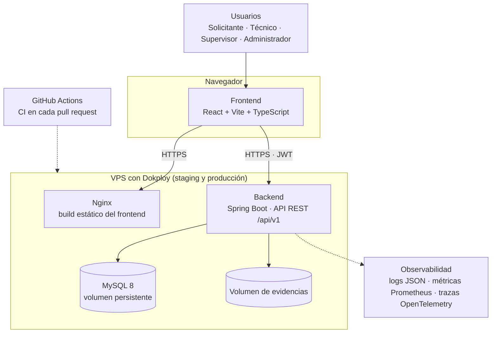
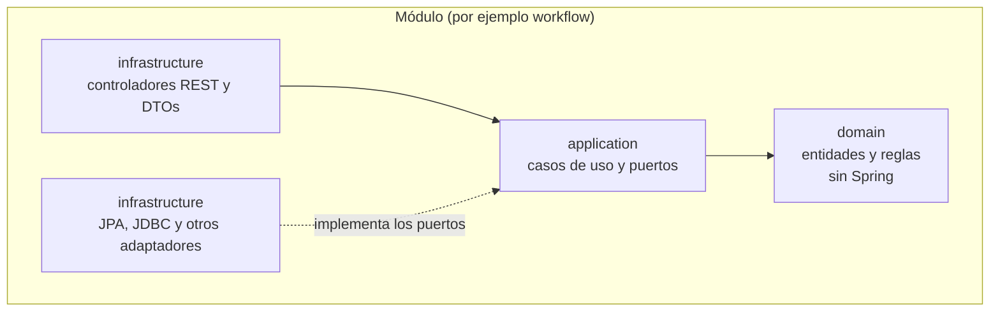
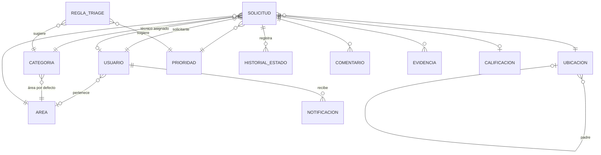
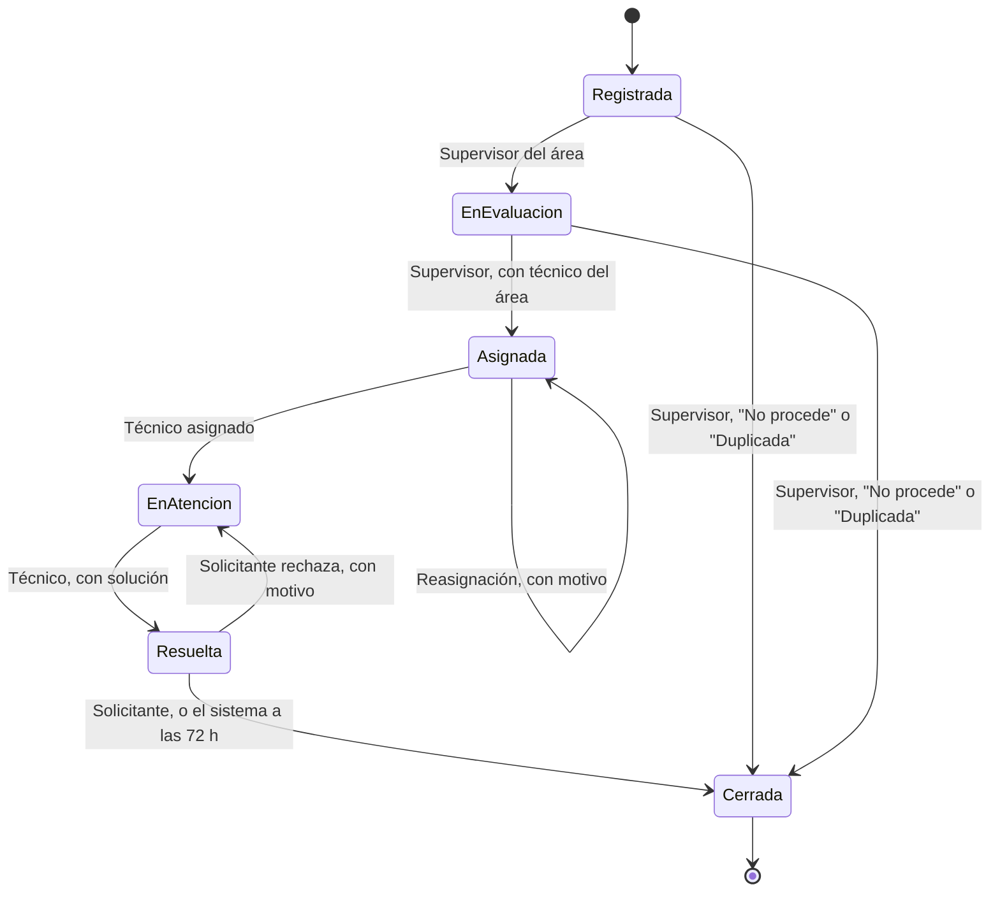
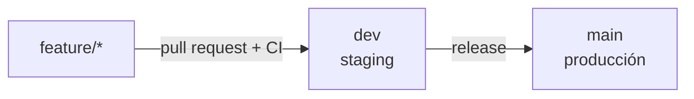

# 04 — Arquitectura preliminar

Resumen de las decisiones del [spec de diseño](../specs/2026-10-14-servicios-universitarios-design.md#3-arquitectura) (sección 3). Cuando algo cambie, se cambia primero el spec.

## 1. Vista general



El navegador recibe el frontend como archivos estáticos y habla con la API por HTTPS. El token de acceso vive en memoria; el de renovación, en una cookie `HttpOnly`, `Secure`, `SameSite=Strict`.

## 2. Repositorio

```text
/
├── backend/            Spring Boot (Maven)
├── frontend/           React + Vite + TypeScript
├── infra/              docker-compose, configuración de despliegue, pruebas de carga y DAST
├── docs/               specs, documentos de fase, informes y manuales
├── odd/tasks/          seguimiento de features
└── .github/workflows/  CI
```

## 3. Backend: monolito modular

Java 25 y Spring Boot. Paquete raíz `pe.edu.unmsm.servicios`, con un paquete por módulo: `auth`, `catalog`, `requests`, `workflow`, `dashboard`, `admin`, `notifications`, `triage`, `satisfaction` y `shared`.

Cada módulo sigue una arquitectura hexagonal liviana:



Reglas de dependencia, verificadas con ArchUnit en cada `mvn verify`:

- `domain` no depende de frameworks.
- `application` no depende de `infrastructure`.
- Los módulos se comunican solo a través de su capa `application` (por ejemplo, `workflow` usa el puerto `RequestStateStore` de `requests`, y consulta a los técnicos con su propio puerto `TechnicianDirectory`, cuyo adaptador usa la capa `application` de `auth`).

Otras decisiones:

| Tema | Decisión |
|---|---|
| Persistencia | MySQL 8 con Spring Data JPA; esquema versionado con Flyway; consultas de lectura con joins para los listados |
| API | REST bajo `/api/v1`, documentada con OpenAPI (springdoc) y Swagger UI |
| Errores | Un solo formato, RFC 7807 (`application/problem+json`), con un campo `errors` por campo inválido |
| Concurrencia | Las transiciones bloquean la fila de la solicitud y usan control de versión; el código de solicitud sale de un contador atómico por año |
| Pruebas | JUnit 5 sin Spring para el dominio; `@SpringBootTest` con Testcontainers (MySQL real) para endpoints; ArchUnit para la arquitectura |

## 4. Frontend

React + Vite + TypeScript en modo estricto, con carpetas por feature:

```text
frontend/src/
├── app/          enrutado, layout y proveedores
├── features/     auth, requests, workflow, collaboration, notifications, triage,
│                 satisfaction, dashboard, admin
├── shared/       ui (componentes reutilizables), api (cliente y tipos), domain, hooks, session, lib
└── mocks/        API simulada con MSW
```

| Tema | Decisión |
|---|---|
| Estado del servidor | TanStack Query |
| Formularios y validación | React Hook Form + Zod |
| Estilos | Tailwind CSS con tokens de diseño, modo claro y oscuro, responsive |
| Gráficas | Recharts |
| API simulada | MSW: la interfaz funciona sin backend con `pnpm dev:mocks` |
| Pruebas | Vitest + Testing Library con MSW |

## 5. Modelo de datos principal



Campos clave: ver la [sección 7 del spec](../specs/2026-10-14-servicios-universitarios-design.md#7-modelo-de-datos-principal). Las migraciones están en `backend/src/main/resources/db/migration/`.

## 6. Ciclo de vida de una solicitud



Toda transición genera una entrada de historial. Cualquier transición que no está en el diagrama se rechaza con `409`.

## 7. Seguridad

| Aspecto | Decisión |
|---|---|
| Autenticación | JWT: acceso de 15 minutos y renovación de 7 días con rotación |
| Contraseñas | BCrypt |
| Autorización | Por rol en cada endpoint y verificación de pertenencia (`AccessPolicy`) |
| Entradas | Validación en el backend (Bean Validation) y en el frontend (Zod) |
| Secretos | Solo en variables de entorno; nunca en el repositorio |
| Protección de la API | Cabeceras de seguridad, CORS restringido al dominio del frontend y límite de intentos de login |
| Revisión | OWASP Top 10 en la Fase III; SAST y DAST en la Fase IV |

## 8. Flujo de trabajo y despliegue



- Commits con Conventional Commits.
- **CI** (GitHub Actions) en cada pull request y push a `dev` o `main`: backend con `mvn verify`; frontend con lint, verificación de tipos, pruebas y build.
- **CD** (Dokploy en una VPS propia): una aplicación Docker Compose por entorno, con backend, frontend servido por Nginx y MySQL con volumen persistente; despliegue automático por push; HTTPS gestionado por Dokploy.

## 9. Observabilidad

Logs estructurados en JSON con identificador de traza, métricas con Actuator y Micrometer (endpoint Prometheus) y trazas con OpenTelemetry. Los paneles y las alertas se construyen en la Fase IV (decisión abierta D3: Prometheus y Grafana en la misma VPS o un servicio externo).
