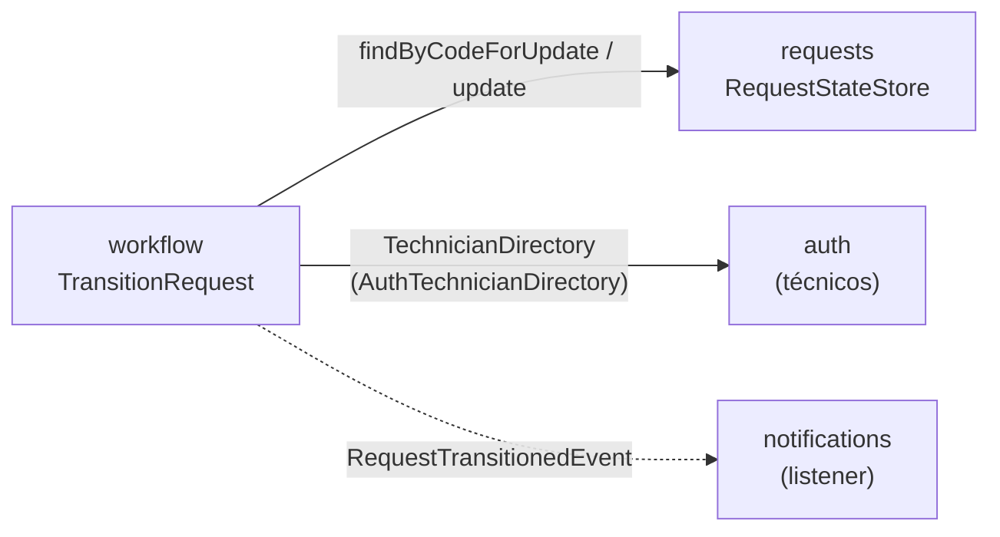

# Manual técnico — módulo de flujo de atención (`workflow`)

Responsable: Angela. Última revisión: 14 de noviembre de 2026.

Este manual explica cómo está construido el ciclo de vida de las solicitudes: la máquina de estados, la asignación, el historial y las pantallas que los usan. Lita lo consolida con los demás módulos en el manual técnico final. Las reglas de negocio vienen de la [sección 6 del spec](../specs/2026-10-14-servicios-universitarios-design.md#6-máquina-de-estados) y el contrato de la API, de [`contrato-v1.md`](../api/contrato-v1.md) y [`ui-extensions.md`](../api/ui-extensions.md#semántica-de-post-requestscodetransitions-módulo-workflow).

## 1. Qué hace el módulo

| Responsabilidad | Dónde |
|---|---|
| Decidir si un usuario puede pasar una solicitud de un estado a otro, y qué datos exige | `workflow/domain/StateMachine` |
| Aplicar la transición, guardar el historial y avisar a otros módulos | `workflow/application/TransitionRequest` |
| Calcular qué transiciones puede hacer cada usuario sobre una solicitud (`allowedTransitions`) | `workflow/application/WorkflowAllowedTransitions` |
| Listar los técnicos activos de un área con su carga | `workflow/application/ListTechnicians` |
| Exponer `POST /requests/{code}/transitions` y `GET /users/technicians` | `workflow/infrastructure/web` |
| Bandejas, acciones y diálogos de la interfaz | `frontend/src/features/workflow/` |

Lo que **no** es de este módulo: registrar y consultar solicitudes (`requests`), calificar y el cierre automático a las 72 h (`satisfaction`), comentarios y notificaciones (`collaboration`, `notifications`).

## 2. Estructura

```text
backend/src/main/java/pe/edu/unmsm/servicios/workflow/
├── domain/           StateMachine, TransitionCommand, TransitionOutcome, WorkflowSubject, Technician,
│                     InvalidTransitionException (409), TransitionForbiddenException (403),
│                     InvalidTransitionDataException (400)
├── application/      TransitionRequest, ListTechnicians, WorkflowAllowedTransitions,
│                     TechnicianDirectory (puerto), TechnicianView
└── infrastructure/   WorkflowConfig, AuthTechnicianDirectory (adaptador),
    └── web/          TransitionsController, TechniciansController, WorkflowDtos, WorkflowExceptionHandler
```

Sigue la arquitectura hexagonal liviana del resto del backend ([04, sección 3](../fase-1/04-arquitectura.md#3-backend-monolito-modular)); `ArchitectureTest` falla si `domain` usa Spring o si `application` depende de `infrastructure`.

Cómo se relaciona con otros módulos, siempre por puertos:



- `workflow` lee y escribe la solicitud solo a través del puerto `RequestStateStore` de `requests`.
- Los técnicos se consultan con el puerto propio `TechnicianDirectory`; su adaptador usa la capa `application` de `auth`.
- Tras cada transición se publica `RequestTransitionedEvent`. `notifications` lo escucha (después del commit, en una transacción nueva) y genera los avisos; un fallo ahí no deshace la transición.

## 3. La máquina de estados

`StateMachine` es dominio puro: no usa Spring ni base de datos, así que cada fila de la tabla se prueba con una prueba unitaria.

| Desde | Hacia | Paso | Quién puede | Datos que exige |
|---|---|---|---|---|
| Registrada | En evaluación | `EVALUATE` | Supervisor del área | — |
| En evaluación | Asignada | `ASSIGN` | Supervisor del área | `technicianId` de un técnico activo del área |
| Asignada | Asignada | `REASSIGN` | Supervisor del área | Técnico activo del área, distinto del actual, y `reason` |
| Asignada | En atención | `START` | Técnico asignado | — |
| En atención | Resuelta | `RESOLVE` | Técnico asignado | `reason` (comentario de solución) |
| Resuelta | Cerrada | `CONFIRM` | Solicitante dueño | — (la calificación se guarda aparte) |
| Resuelta | En atención | `REJECT` | Solicitante dueño | `reason` |
| Registrada o En evaluación | Cerrada | `CLOSE_UNRESOLVED` | Supervisor del área | `closureReason` = `NO_PROCEDE` o `DUPLICADA` |

El cierre automático a las 72 h no pasa por esta tabla: lo hace `satisfaction` (ver [`ui-extensions.md`](../api/ui-extensions.md#cierre-automático-módulo-satisfaction)).

### Orden de validación

El código HTTP es predecible porque las comprobaciones siempre van en este orden:

1. **`409 Conflict`**: la transición no está en la tabla. Se responde igual para cualquier usuario, incluso si además no tiene permiso.
2. **`403 Forbidden`**: la transición existe pero el usuario no puede hacerla (no es el supervisor del área, no es el técnico asignado, no es el dueño).
3. **`400 Bad Request`**: faltan datos. Solo se le dice qué falta a quien está autorizado. El cuerpo trae `errors` por campo (`technicianId`, `reason`, `closureReason`).

El motivo se recorta y no puede superar 400 caracteres.

### Qué queda en el historial

Cada transición guarda una entrada con estado anterior, estado nuevo, usuario, fecha, técnico (si cambió) y un texto. El texto lo arma `StateMachine`:

| Paso | Texto del historial |
|---|---|
| `EVALUATE` | `Se inició la evaluación del caso` |
| `ASSIGN` | `Asignada a <técnico>` |
| `REASSIGN` | `Reasignada a <técnico>. Motivo: <motivo>` |
| `START` | `Atención iniciada en sitio` |
| `RESOLVE` | `Solución: <comentario>` |
| `CONFIRM` | `Solución confirmada por el solicitante` (más `: <texto>` si lo hay) |
| `REJECT` | `Solución rechazada: <motivo>` |
| `CLOSE_UNRESOLVED` | `No procede` o `Duplicada` (más `: <texto>` si lo hay) |

La interfaz de satisfacción lee el prefijo `Solución: ` del historial para mostrar la «solución propuesta» al solicitante; si se cambia ese texto hay que cambiar también `frontend/src/features/satisfaction/lib/solution.ts`.

## 4. Concurrencia y consistencia

`TransitionRequest.execute` es `@Transactional` y:

1. Lee la solicitud con `findByCodeForUpdate` (bloqueo pesimista de la fila). Dos transiciones simultáneas se deciden una después de la otra: la segunda ya ve el estado nuevo y recibe `409` si deja de ser válida.
2. Aplica `StateMachine.transition` sobre un `WorkflowSubject` (estado, solicitante, área y técnico actuales).
3. Guarda la solicitud y la entrada de historial en la misma transacción. Si algo falla, no se escribe nada.
4. Publica `RequestTransitionedEvent`.

Además la entidad lleva un número de versión (`@Version`): si otro cambio se confirmó primero, se responde `409` con «La solicitud cambió mientras la procesábamos. Vuelve a intentarlo». La prueba `WorkflowApiTests.twoSimultaneousIdenticalTransitionsOnlyOneWins` lo ejercita con dos hilos.

## 5. API

### `POST /api/v1/requests/{code}/transitions`

Cuerpo: `{ "to": "ASIGNADA", "reason": "…", "technicianId": 5, "closureReason": "NO_PROCEDE" }`. Solo `to` es obligatorio siempre; los demás campos dependen del paso (tabla de la sección 3). Estados válidos: `REGISTRADA`, `EN_EVALUACION`, `ASIGNADA`, `EN_ATENCION`, `RESUELTA`, `CERRADA`.

| Código | Cuándo |
|---|---|
| `200` | Devuelve el detalle actualizado de la solicitud, con su `allowedTransitions` para quien la pidió |
| `400` | Falta `to`, o un dato que el paso exige (campo en `errors`) |
| `401` | Sin token |
| `403` | El usuario no puede hacer esa transición |
| `404` | La solicitud no existe |
| `409` | Transición fuera de la tabla, solicitud ya cerrada, o cambio concurrente |

Ejemplo (asignar):

```bash
curl -X POST http://localhost:8088/api/v1/requests/SOL-2026-000001/transitions \
  -H "Authorization: Bearer $TOKEN" -H "Content-Type: application/json" \
  -d '{"to":"ASIGNADA","technicianId":5}'
```

### `GET /api/v1/users/technicians?areaId=`

Solo supervisores, y solo de su propia área (si no se manda `areaId`, se usa la suya; otra área da `403`). Devuelve `[{ id, fullName, activeRequests }]`, donde `activeRequests` cuenta las solicitudes Asignadas y En atención de cada técnico. Solo aparecen técnicos activos.

### `allowedTransitions` en el detalle

`GET /requests/{code}` incluye los estados a los que **ese usuario** puede mover la solicitud, calculados con `StateMachine.allowedTransitions`. No dice si los datos serán suficientes, solo si el paso existe y el usuario puede hacerlo.

## 6. Frontend (`frontend/src/features/workflow/`)

| Archivo | Función |
|---|---|
| `ActionsPanel.tsx` | Panel «Acciones» del detalle: un botón por cada acción permitida; no dibuja nada si no hay |
| `ActionModal.tsx` | Diálogo de la acción: pide técnico, prioridad o motivo según corresponda, valida con Zod y llama a la API |
| `KanbanBoard.tsx` | Tablero por estado; arrastrar solo funciona para transiciones del rol |
| `lib/transitions.ts` | `ACTION_CONFIG` (qué pide cada acción), `actionsFromTransitions` (de `allowedTransitions` a botones) y `resolveTransition` (de arrastre a acción) |
| `lib/sla.ts` | Tiempo restante y marca de vencida |
| `schemas/action.ts` | Esquema del formulario y traducción a la llamada de la API (`toApiCall`) |
| `api.ts` | `useWorkflowAction` y `useTechnicians` (TanStack Query) |

Reglas que conviene no romper:

- **La interfaz no decide los permisos.** Los botones salen de lo que el servidor permite (`allowedTransitions`); el tablero usa una copia de la tabla solo para avisar antes de llamar, y el servidor sigue siendo quien decide.
- **Un `409` no es un error del usuario.** `ActionModal` avisa «Transición no permitida», refresca las consultas de solicitudes y cierra el diálogo, porque casi siempre significa que otra persona cambió la solicitud antes.
- **Un `400` se muestra junto al campo** (`technicianId`, `reason`, `priorityId`); un `403` u otro error, en el diálogo, que queda abierto para reintentar.
- Confirmar o rechazar la solución **no** está en este módulo: lo ofrece `features/satisfaction` al solicitante.

## 7. Pruebas

| Capa | Archivo | Cantidad | Qué cubre |
|---|---|---|---|
| Dominio | `workflow/domain/StateMachineTest` | 50 | Cada fila de la tabla válida; transiciones inválidas (`409`); permisos (`403`); datos faltantes (`400`); orden de validación |
| Casos de uso | `TransitionRequestTest` (8), `ListTechniciansAndAllowedTransitionsTest` (5) | 13 | Historial, eventos, bloqueo, técnicos del área, transiciones permitidas |
| Integración | `workflow/infrastructure/WorkflowApiTests` | 20 | Los endpoints con MySQL real (Testcontainers): flujo completo con seis entradas de historial, rechazo de la solución, cierres, `403` por rol, `400` por datos, `409` y simultaneidad |
| Interfaz | `features/workflow/*.test.ts(x)` | 78 | Lógica pura (`lib/`, `schemas/`) y componentes: `ActionsPanel`, `ActionModal` (cada acción y los errores `400`, `403`, `409`), `KanbanBoard` (arrastres válidos e inválidos por rol) |

Cómo ejecutarlas (Docker debe estar en marcha para las de integración):

```bash
cd backend  && ./mvnw verify -Dtest='StateMachineTest,TransitionRequestTest,WorkflowApiTests'
cd frontend && pnpm vitest run src/features/workflow
```

La trazabilidad entre cada escenario BDD y su prueba está en [`docs/fase-1/03-epicas-y-historias.md`](../fase-1/03-epicas-y-historias.md#e3-flujo-de-atención) (HU-12 a HU-19).

## 8. Cómo agregar o cambiar una transición

1. Cambia primero la tabla en el spec (§6) y en este manual.
2. En `StateMachine`: agrega el caso en `stepFor`, el permiso en `mayPerform` y la validación y el texto de historial en `transition`.
3. Escribe antes las pruebas en `StateMachineTest` y `WorkflowApiTests`.
4. En el frontend: `ACTION_CONFIG`, `actionsFromTransitions` y `resolveTransition` en `lib/transitions.ts`, más el esquema en `schemas/action.ts` y los mocks de `frontend/src/mocks/handlers/requests.ts`, y sus pruebas.
5. Actualiza el contrato en `docs/api/` y la trazabilidad en `docs/fase-1/03`.

## 9. Limitaciones conocidas

| Tema | Estado |
|---|---|
| Cambiar la prioridad de una solicitud (`PATCH /requests/{code}/priority`, con recálculo del vencimiento) | Tiene contrato, interfaz y mock, pero **no está implementado en el backend**; con el backend real el botón no se ofrece |
| El cierre como «No procede» o «Duplicada» exige el tipo de cierre en el servidor; el texto libre es opcional en la API, pero la interfaz lo exige (mínimo 5 caracteres) | Decisión de interfaz |
| Cierre automático a las 72 h | Lo implementa `satisfaction` (tarea cada 15 minutos), no `workflow` |

## 10. Solución de problemas

| Síntoma | Causa probable |
|---|---|
| El detalle no muestra botones | El usuario no tiene transiciones permitidas (otro área, no es el técnico asignado o la solicitud está cerrada); revisa `allowedTransitions` en la respuesta |
| `409` al evaluar o asignar una solicitud que parece estar en el estado correcto | Otra persona la movió antes; refresca la lista |
| `400` al asignar | El técnico está inactivo, es de otra área o no se envió `technicianId` |
| `403` al listar técnicos | El usuario no es supervisor, o pide otra área |
| Una prueba de integración falla con «Could not find a valid Docker environment» | Docker no está en marcha |
